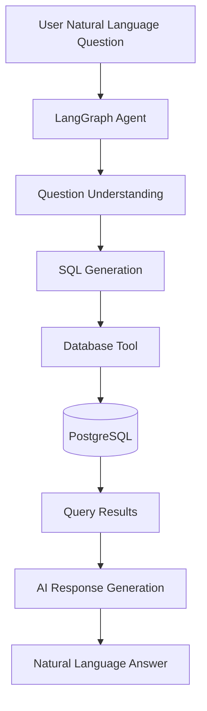

# 🗄️ NaturalSQL – AI-Powered SQL Assistant

### Query Your Database Using Natural Language with LangGraph and Groq

NaturalSQL is an AI-powered database assistant that allows users to interact with databases using natural language instead of writing SQL queries manually.

The system uses an AI agent to understand user questions, generate and execute database queries through tools, and return results in an understandable format.

Built using Python, LangGraph, LangChain, Groq, SQLAlchemy, and PostgreSQL, NaturalSQL demonstrates how Large Language Models can simplify database interaction through natural-language-to-SQL workflows.

## 🚀 How to Use

### Prerequisites

- Python 3.10+
- PostgreSQL
- Git
- Groq API Key

### 1. Clone the Repository

```bash
git clone https://github.com/hmzsrx/NaturalSQL.git
cd NaturalSQL
```

### 2. Create Virtual Environment

**Windows:**

```bash
python -m venv venv
venv\Scripts\activate
```

**Mac/Linux:**

```bash
python3 -m venv venv
source venv/bin/activate
```

### 3. Install Dependencies

```bash
pip install -r requirements.txt
```

### 4. Configure Environment Variables

Create a `.env` file:

```env
GROQ_API_KEY=your_groq_api_key
DATABASE_URL=your_postgresql_database_url
```

Replace the values with your actual API key and PostgreSQL connection URL.

### 5. Run Database Migrations

```bash
alembic upgrade head
```

### 6. Start the Application

```bash
python main.py
```

You can now ask database-related questions directly in the terminal.

Press `Ctrl + C` to stop the application.

## 🏗️ Project Architecture



### Technology Stack

- Python
- LangChain
- LangGraph
- LangChain Groq
- Groq LLM
- SQLAlchemy
- PostgreSQL
- Alembic
- Python Dotenv

## ✨ Key Features

- Natural-language database interaction.
- AI-powered SQL query generation.
- LangGraph-based agent workflow.
- Database query execution through tools.
- PostgreSQL integration.
- SQLAlchemy ORM.
- Database migrations using Alembic.
- Conversational question-answering interface.
- Persistent thread configuration.

## 👨‍💻 Contributing

Contributions are welcome!

1. Fork the repository.
2. Create a new branch.
3. Implement your changes.
4. Test SQL generation and execution.
5. Commit and push your changes.
6. Open a Pull Request.

Please follow the existing database and agent architecture.

## ⚠️ Known Issues & Future Improvements

Potential improvements:

- Add support for multiple database engines.
- Improve SQL query validation.
- Add query execution safety checks.
- Introduce a web-based interface.
- Add database schema visualization.
- Improve conversational memory.
- Add query history and analytics.
- Implement advanced error handling.

## ⭐ Support

If you find NaturalSQL useful, consider giving this repository a ⭐ on GitHub.

Your support and contributions are appreciated!

---

**Built with ❤️ using Python, LangGraph, Groq, and PostgreSQL.**
